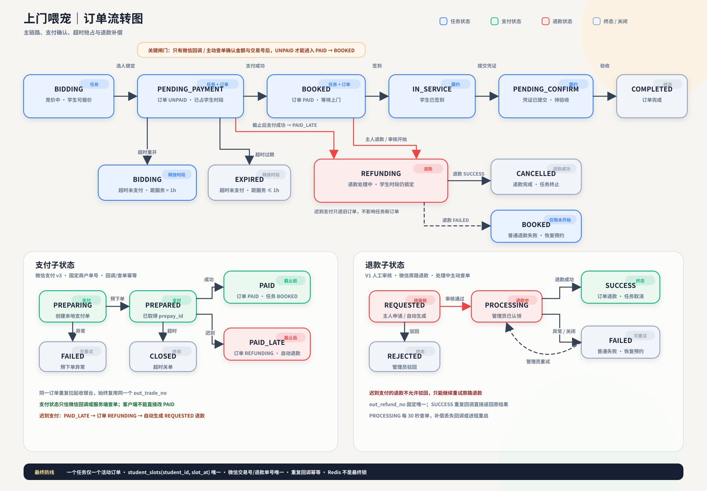

# 订单状态机与支付一致性



## 1. 核心原则

1. 客户端不能把订单改成“已支付”。唯一可信来源是微信支付回调或服务端主动查单。
2. 一个主人任务最多只有一个有效成交订单；一个学生同一时间片最多只能接一单。
3. 并发正确性由 SQLite 事务和唯一索引保证，Redis 不是最终锁。
4. 微信重复回调必须幂等；金额、商户号、交易号不一致必须拒绝。
5. 超时支付不能重新确认订单，只能进入退款流程。

## 2. 任务状态

```text
BIDDING
  └─ 主人选定学生
       └─ PENDING_PAYMENT
            ├─ 截止前支付成功 ──> BOOKED
            │                    ├─ 学生签到 ──> IN_SERVICE
            │                    │               └─ 提交凭证 ──> PENDING_CONFIRM
            │                    │                                └─ 主人验收 ──> COMPLETED
            │                    └─ 主人申请退款且审核开始 ──> REFUNDING
            │                                             ├─ 退款成功 ──> CANCELLED
            │                                             └─ 退款失败 ──> BOOKED（服务尚未开始）
            ├─ 截止未支付 ──> BIDDING（距离服务超过 1 小时，可重新竞价）
            ├─ 截止未支付 ──> EXPIRED（距离服务不足 1 小时）
            └─ 截止后支付成功 ──> REFUNDING（自动创建退款申请）
```

## 3. 订单状态

```text
UNPAID -> PAID -> IN_SERVICE -> PENDING_CONFIRM -> COMPLETED
   |        |
   |        +-> REFUNDING -> REFUNDED
   |                    └-> PAID（普通退款失败，且服务尚未开始）
   +-> CANCELLED（撤单、换人、支付超时）
```

退款处理中，任务保持 `REFUNDING`，学生时段仍由 `student_slots` 占用，避免重复成交。`REFUNDING` 不放进 `orders` 的活动任务唯一索引，是为了处理“旧订单已超时释放、任务已重新成交，旧支付才到账”的场景：旧订单可以进入退款，但不会与任务的新订单冲突。

## 4. 支付状态

```text
PREPARING -> PREPARED -> PAID
                    ├-> PAID_LATE（迟到支付，强制退款）
                    ├-> FAILED
                    └-> CLOSED（超时关单）
```

- `out_trade_no` 固定为 `zoo_<orderID>`，同一订单重复拉起收银台不会生成新的商户单号。
- 微信侧支付成功但本地订单已取消/超时时，回调记录 `PAID_LATE`，订单与任务进入 `REFUNDING`，并自动生成 `REQUESTED` 退款单。
- 支付回调先做平台证书/公钥验签，再使用 APIv3 密钥做 `AEAD_AES_256_GCM` 解密。
- 回调金额必须同时匹配 `payments.amount_fen` 和 `orders.amount_fen`；交易号在数据库中唯一。

## 5. 退款状态

```text
REQUESTED -> PROCESSING -> SUCCESS
     |             └------> FAILED -> PROCESSING（管理员重试）
     └-> REJECTED

SUCCESS 是不可逆终态；重复成功回调直接返回原结果。
```

- 普通退款只允许在服务开始前发起，由管理员审核后调用微信退款。
- 迟到支付产生的退款不能驳回，必须原路退回。
- `out_refund_no` 固定且唯一，微信退款接口本身也具备幂等性。
- 服务端定时查询处于 `PROCESSING` 的退款，补偿丢失回调或进程重启。

## 6. 数据库最终防线

```sql
-- 一个任务只允许一个活动订单
CREATE UNIQUE INDEX ux_orders_active_task ON orders(task_id)
WHERE status IN ('UNPAID', 'PAID', 'IN_SERVICE', 'PENDING_CONFIRM');

-- 一个学生同一 30 分钟时间片只允许一个活动占位
CREATE TABLE student_slots (
  student_id TEXT NOT NULL,
  slot_at TEXT NOT NULL,
  order_id TEXT NOT NULL,
  PRIMARY KEY (student_id, slot_at)
);

-- 支付与退款幂等键
CREATE UNIQUE INDEX ux_payments_transaction ON payments(wechat_transaction_id)
WHERE wechat_transaction_id <> '';
CREATE UNIQUE INDEX ux_refunds_active_order ON refunds(order_id)
WHERE status IN ('REQUESTED', 'PROCESSING', 'SUCCESS');
```

即使两个主人同时选中同一学生的同一时段，也只有一个事务能完成 `student_slots` 写入，另一个会回滚并收到“该学生当前时段已有其他有效订单”。

## 7. 并发管控顺序

```text
选人：BEGIN -> 校验任务版本 -> 创建订单 -> 占用学生时间片 -> COMMIT
支付：创建固定商户单号 -> 微信预下单 -> 客户端调起支付 -> 微信回调
回调：验签解密 -> BEGIN -> 校验金额/交易号 -> 更新订单和任务 -> COMMIT
超时：先关闭微信支付单 -> 再取消本地订单 -> 释放时间片 -> 重开竞价
退款：申请单落库 -> 管理员认领为 PROCESSING -> 调微信退款 -> 回调/查单落终态
```

Redis 可用于缓存、限流、消息通知，但不能替代上述数据库唯一约束和事务。
